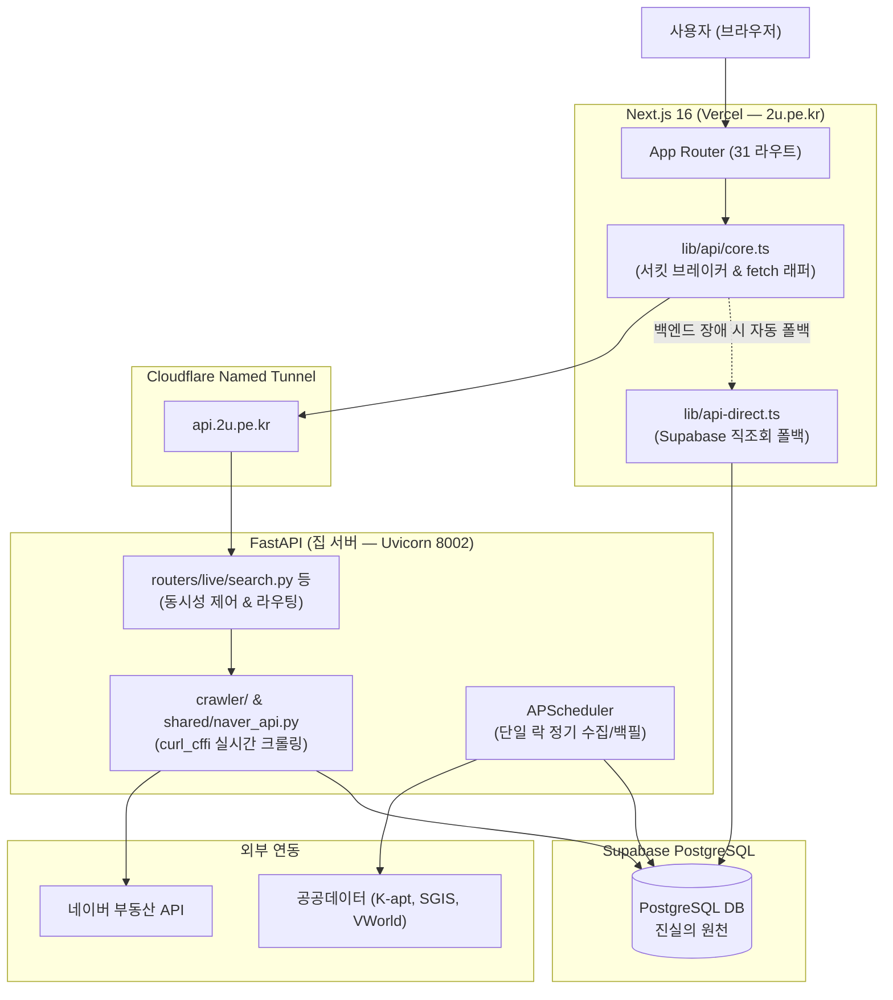

# 2u부동산 (내 프로젝트) — 온보딩 지도 & 아키텍처 가이드

> **공인중개사 B2B 구독** 부동산 SaaS `2u.pe.kr` (이 서비스)의 웹 모노레포 프로젝트입니다.  
> 네이버 부동산 실시간 크롤링 및 단지·매물 데이터 분석, 정밀 세무·비교 도구를 제공합니다.

---

## 🏗️ 시스템 아키텍처



---

## 🛠️ 기술 스택

| 구분 | 기술 스택 | 근거 및 설명 |
|---|---|---|
| **Frontend** | Next.js 16.4 (App Router), React 19, TypeScript 6 | `frontend/package.json` |
| **FE 스타일/상태** | Tailwind CSS 4, shadcn/Radix, TanStack React Query v5 | 반응형 모바일 지원 및 서버 상태 관리 |
| **Backend** | FastAPI, Python 3.12, SQLAlchemy 2.1, Uvicorn | `backend/requirements.txt` |
| **크롤링/스케줄러** | `curl_cffi` (네이버 차단 방지), `APScheduler` (단일 인스턴스 파일락) | 실시간 크롤링 및 백그라운드 수집 |
| **데이터베이스** | Supabase (PostgreSQL 15+), Supabase Auth (쿠키 기반 JWT) | Flyway 스타일 마이그레이션 (V001~V071) |
| **배포/인프라** | Vercel (FE, Root: `frontend`) + 집 서버 (BE, Named Tunnel) | `CLAUDE.md`, `frontend/README.md` |
| **검증/CI** | GitHub Actions, Vitest, Playwright(E2E), Ruff, pytest-xdist | `.github/workflows/ci.yml` |

---

## 📁 디렉토리 구조 및 역할

| 디렉토리 | 설명 | 진입점 / 상세 문서 |
|---|---|---|
| [`frontend/`](./frontend/) | Next.js 16 웹 프론트엔드 소스 | [frontend/README.md](./frontend/README.md) |
| [`backend/`](./backend/) | FastAPI 백엔드 API & 크롤러 소스 | [backend/CLAUDE.md](./backend/CLAUDE.md) |
| [`.claude/`](./.claude/) | Claude Code 규칙(rules 12종), 훅(hooks), 전문 에이전트(agents) | [.claude/STRUCTURE.md](./.claude/STRUCTURE.md) |
| [`.github/`](./.github/) | GitHub Actions 워크플로우 (CI, E2E, 보안 감사) | [.github/workflows/ci.yml](./.github/workflows/ci.yml) |
| [`scripts/`](./scripts/) | 서버 자동 시작, 오케스트레이터, 텔레그램 알림 | `scripts/startup_orchestrator.py` |
| [`docs/`](./docs/) | 아키텍처 스펙, 비즈니스 결정, 데이터 소스 문서 | [docs/DATA_SOURCES.md](./docs/DATA_SOURCES.md) |

---

## 🚀 빠른 시작 (개발 환경)

### 1. 프론트엔드 실행
```bash
cd frontend
npm install                          # 최초 1회 (husky 훅 자동 구성)
PLAYWRIGHT_PORT=8090 npm run dev     # 개발 서버 구동 (기본 포트: 8090)
```

### 2. 백엔드 실행
```bash
cd backend
# 가상환경 활성화 후
pip install -r requirements.txt
uvicorn main:app --host 0.0.0.0 --port 8002 --reload
```

---

## ✅ 커밋 전 필수 검증

작업 후 git commit 전 반드시 아래 검증을 통과해야 CI가 실패하지 않습니다:

```bash
# [1] 백엔드 변경 시
cd backend && ruff check . && python -m pytest --tb=short -q

# [2] 프론트엔드 변경 시 (타입/린트/테스트 + CI 게이트 4종)
cd frontend && npx tsc --noEmit && npm run lint && npm test \
  && npm run check:ad-compliance && npm run check:mdx-jsx && npm run check:job-labels \
  && npm run check:visual-guard
```

---

## 📚 주요 문서 바로가기

- [전체 프로젝트 규칙 및 SSOT (`CLAUDE.md`)](./CLAUDE.md)
- [기여 및 커밋 가이드 (`CONTRIBUTING.md`)](./CONTRIBUTING.md)
- [프론트엔드 상세 가이드 (`frontend/README.md`)](./frontend/README.md)
- [E2E 및 시각 회귀 테스트 안내 (`frontend/e2e/README.md`)](./frontend/e2e/README.md)
